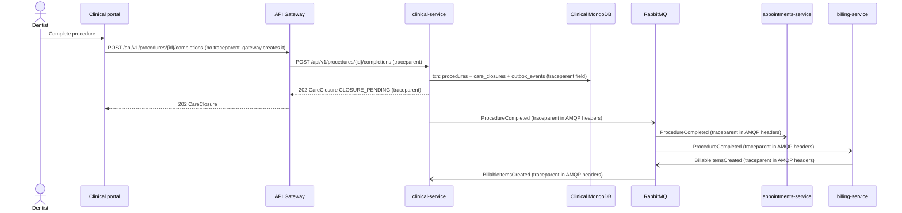

# CP1 - Critical journey and trace map

## Journey: complete a procedure

A Dentist finishes a planned procedure while the patient is still in the chair. `clinical-service` (Go) commits the
completed procedure and its `ProcedureCompleted` outbox entry in one MongoDB transaction and answers `202` with a
`CareClosure`. RabbitMQ then delivers the fact to `appointments-service` (individual procedure progress) and
`billing-service` (charge snapshots), and Billing reports back with `BillableItemsCreated`.

Why this one: it crosses the API Gateway, `clinical-service`, Clinical MongoDB, RabbitMQ, `appointments-service` and
`billing-service`, and it mixes one synchronous request with an asynchronous fan-out. A lost or duplicated message
here means an appointment that never shows progress, or a missing or duplicated charge.

Sources: `dlc-docs` 05-architecture/overview.md (care-closing sequence), 02-domain/domain-events.md
(`ProcedureCompleted`), 07-api/contracts/openapi/clinical-service.yaml (`ClinicalCompleteprocedure`).

## Hops

| Step | Caller | Receiver | Protocol | Operation | Sync/Async | Data touched | Trace context |
|---|---|---|---|---|---|---|---|
| 1 | Clinical portal (React, inside `dlc-front`) | API Gateway | REST | `POST /api/v1/procedures/{id}/completions` | sync | none | gateway starts the trace (no incoming `traceparent`) |
| 2 | API Gateway | `clinical-service` | REST | `POST /api/v1/procedures/{id}/completions` | sync | none | `traceparent` header |
| 3 | `clinical-service` | Clinical MongoDB | MongoDB driver | transaction: procedure `COMPLETED` + extras + `CareClosure` + outbox event | sync | `procedures`, `procedure_extras`, `care_closures`, `outbox_events`, `idempotency_keys` | `traceparent` saved as a field of the outbox document |
| 4 | `clinical-service` outbox relay | RabbitMQ | AMQP | publish `ProcedureCompleted` v1 | async | `outbox_events` (mark sent) | `traceparent` copied from the outbox document into AMQP message headers |
| 5 | RabbitMQ | `appointments-service` | AMQP | consume `ProcedureCompleted`, record procedure progress | async | PostgreSQL schema `appointments` (inbox + progress) | `traceparent` read from message headers |
| 6 | RabbitMQ | `billing-service` | AMQP | consume `ProcedureCompleted`, create UNBILLED charge snapshots | async | PostgreSQL schema `billing` (inbox + snapshots + outbox) | `traceparent` read from message headers |
| 7 | `billing-service` -> RabbitMQ -> `clinical-service` | | AMQP | `BillableItemsCreated` updates the `CareClosure` | async | billing outbox; clinical `inbox_events`, `care_closures` | `traceparent` kept from step 6 |

The relay step is the weak point: the HTTP request has already ended when the message is published, so the trace
context must travel inside the outbox document or the trace breaks between steps 3 and 4.

## Sequence diagram

## Span tree

All spans share the same `trace_id`.

- `POST /api/v1/procedures/{id}/completions` - API Gateway (root, SERVER)
  - `POST /api/v1/procedures/{id}/completions` - clinical-service (SERVER)
    - `jwt.verify` - clinical-service (INTERNAL)
    - `mongo.transaction complete_procedure` - clinical-service (CLIENT)
      - `mongo.update procedures`
      - `mongo.insert procedure_extras`
      - `mongo.insert care_closures`
      - `mongo.insert outbox_events`
- `outbox.relay ProcedureCompleted` - clinical-service (INTERNAL, parent = the clinical SERVER span, restored from the outbox document)
  - `ProcedureCompleted publish` - clinical-service (PRODUCER) <- crosses the async boundary
    - `ProcedureCompleted process` - appointments-service (CONSUMER)
      - `postgres.insert appointments.procedure_progress`
    - `ProcedureCompleted process` - billing-service (CONSUMER)
      - `postgres.insert billing.charge_snapshots`
      - `BillableItemsCreated publish` - billing-service (PRODUCER)
        - `BillableItemsCreated process` - clinical-service (CONSUMER)
          - `mongo.insert inbox_events`
          - `mongo.update care_closures`

## Gap with the current code

`dlc-clinical-api` (PR #11) propagates `X-Correlation-Id` and writes it as `traceId`, not a W3C `traceparent`. CP3
adds `traceparent` handling next to it so the same id can cross the gateway, the outbox and RabbitMQ.

Clinical MongoDB collections come from `dlc-clinical-db` (01_ddl/00_collections): `procedures`, `procedure_extras`,
`care_closures`, `outbox_events`, `inbox_events`, `idempotency_keys`. The PostgreSQL table names for Appointments and
Billing are placeholders until checked against their own -db repositories.
