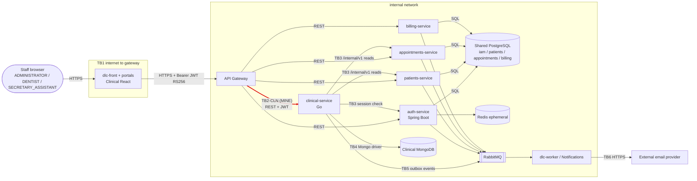

# CP1 - Attack surface map of DLC

Source: `code-corhuila/dlc-docs` - `05-architecture/overview.md`, `09-microservices/service-catalog.md`, `09-microservices/dependency-map.md`, `07-api/endpoint-index.md` and `07-api/authentication.md`.

## Data flow and trust boundaries

| ID | Boundary | Owner (claim issue) |
|---|---|---|
| TB1 | Staff browser / dlc-front to API Gateway | - |
| TB2-AUTH | API Gateway to auth-service (inbound) | @camilo28k (#124) |
| TB2-APT | API Gateway to appointments-service (inbound) | @juan0898 (#129) |
| **TB2-CLN** | **API Gateway to clinical-service (inbound)** | **@LuisBonilla2260 (#130)** |
| TB3 | clinical-service to Patients / Appointments / Auth internal contracts | - |
| TB4 | clinical-service to Clinical MongoDB | - |
| TB5 | services to RabbitMQ (outbox) and broker to dlc-worker | - |
| TB6 | dlc-worker to external email provider | - |

## Asset inventory

| Asset | Where it lives | Classification |
|---|---|---|
| Clinical record content (antecedents, allergies, diagnoses, treatments, procedures) | clinical-service, Clinical MongoDB, in transit through TB2-CLN | Restricted |
| Clinical entries and amendments (`/clinical-entries/{id}/amendments`) | Clinical MongoDB | Restricted |
| Access token (RS256 JWT: `sub`, `sid`, `roles`, `permissions`) | Browser memory, Gateway, clinical-service | Restricted |
| Care completion of a consultation (`care-completions`, `ProcedureCompleted`) | clinical-service, RabbitMQ, billing-service | Confidential |
| Patient ID references and dentist-patient assignment | clinical-service, patients-service, appointments-service | Confidential |
| Clinical Analytics dashboard indicators | clinical-service (`/clinical-analytics/dashboard`) | Internal |
| Public signing keys (JWKS `/api/v1/auth/jwks`) | auth-service | Public |

## Entry points of TB2-CLN (API Gateway to clinical-service)

| Entry point | Caller (role) | Authentication today |
|---|---|---|
| `GET/POST /api/v1/clinical-records` | ADMINISTRATOR, DENTIST | Bearer JWT validated by Gateway; clinical-service must re-verify signature, `iss`, `aud`, `exp` and session |
| `GET /api/v1/clinical-records/{id}` | ADMINISTRATOR, DENTIST | Same, plus assignment check (Dentist only for assigned patients) |
| `GET/POST /api/v1/clinical-records/{id}/entries` | ADMINISTRATOR, DENTIST | Same, plus assignment check |
| `POST /api/v1/clinical-entries/{id}/amendments` | ADMINISTRATOR, DENTIST | Same; original entry is never overwritten |
| `POST /api/v1/clinical-records/{id}/care-completions` | DENTIST only | Same; triggers billing through events |
| `GET /api/v1/clinical-analytics/dashboard` | ADMINISTRATOR, DENTIST, SECRETARY_ASSISTANT | Same; aggregated indicators only |

Key rule from `authentication.md`: the Gateway strips caller-supplied identity headers, but "JWT possession or Gateway validation alone never authorizes an unassigned patient or clinical access by Assistant". clinical-service is the last line of authorization.
