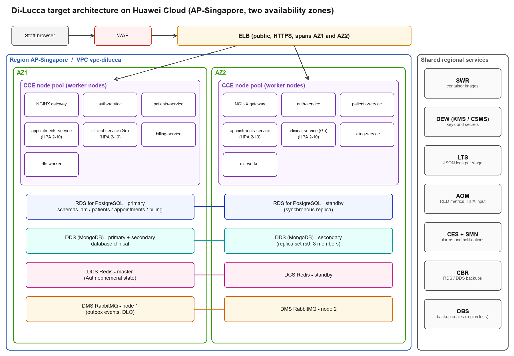

# Architecture design note — Di-Lucca

This note takes the Di Lucca Dental Care platform as it is documented in `dlc-docs` and places it on Huawei Cloud using what the HCCDP-Solution Architectures course teaches. Today the platform runs only on developer machines with Docker Compose (`10-devops/environments.md`), so every cloud value below is a target design, not a deployed fact. Where the team already fixed a number in `dlc-docs`, I reuse it instead of inventing a new one.

## 1. Target architecture

The platform keeps its current logical shape: one API Gateway in front of the transversal auth-service and four business services (Patients, Appointments, Clinical, Billing). Patients, Appointments, Billing and Auth share one PostgreSQL instance with a schema per owner, Clinical owns its MongoDB, and RabbitMQ carries committed facts from each outbox to the other owners and to `dlc-worker`.

On Huawei Cloud the region is AP-Singapore with two availability zones (AZ1 and AZ2). A public ELB receives HTTPS and spreads it over the NGINX gateway pods in both zones. All application containers run in one CCE cluster whose worker nodes are split evenly between AZ1 and AZ2, so losing a zone removes half of the capacity but no service. Images come from SWR.

The stateful parts become managed services with a copy in each zone: RDS for PostgreSQL in primary/standby mode (primary in AZ1, standby in AZ2), DDS as a three-member MongoDB replica set spread over both zones, DCS for Redis in master/standby mode, and DMS for RabbitMQ in cluster mode. CBR and OBS hold backups. LTS, AOM and CES collect logs, metrics and alarms, and SMN sends the alarm notifications. Secrets go to DEW (KMS and CSMS) instead of files on the hosts.

| Component in the diagram | Defined in (file of your team's -docs) |
|---|---|
| API Gateway (NGINX) | `09-microservices/services/01-api-gateway/README.md` |
| auth-service | `09-microservices/services/02-auth-service/README.md` |
| patients-service | `09-microservices/services/03-patients-service/README.md` |
| appointments-service | `09-microservices/services/04-appointments-service/README.md` |
| clinical-service (Go) | `09-microservices/services/05-clinical-service/README.md` |
| billing-service | `09-microservices/services/06-billing-service/README.md` |
| Shared PostgreSQL (schemas `iam`, `patients`, `appointments`, `billing`) | `05-architecture/decisions/ADR-008-postgresql-infrastructure.md` |
| Clinical MongoDB | `05-architecture/decisions/ADR-009-mongodb-infrastructure.md` |
| Redis (Auth ephemeral state) | `05-architecture/overview.md` |
| RabbitMQ and `dlc-worker` | `05-architecture/decisions/ADR-005-hybrid-integration-and-notifications.md` |
| Service map and communication matrix | `09-microservices/service-catalog.md` |

## 2. Five principles

| Principle | Current weakness | Evidence in -docs | Design decision | Huawei Cloud service |
|---|---|---|---|---|
| Reliability | Each stage runs one PostgreSQL and one MongoDB container on one machine; replica-set size and hosting are still pending (P-01). | `10-devops/environments.md` | Run every stateful store with a synchronous copy in a second AZ and spread the stateless pods over both zones (ADR-C3-01). | RDS for PostgreSQL primary/standby, DDS replica set, CCE nodes in AZ1 and AZ2 |
| Security | Secrets live as generated files per Compose project, and there is no managed key store or perimeter filter. | `10-devops/environments.md`, `00-governance/security-policy.md` | Keep the RS256 and per-owner credentials in a managed secret store, put a WAF in front of the ELB and allow database ports only from the CCE node subnet. | DEW (KMS, CSMS), WAF, security groups |
| Performance efficiency | NFR-001 asks for P95 below 300 ms at 100 RPS on critical endpoints, but no metric exists to check it. | `04-requirements/non-functional.md`, `13-operations/observability.md` | Export RED metrics from every service and scale the stateless services on CPU before latency degrades (ADR-C3-02). | AOM, CCE HPA, ELB |
| Cost | The design would duplicate everything if each owner got its own database cluster. | `05-architecture/decisions/ADR-002-polyglot-persistence.md` | Keep one shared RDS instance with schema ownership, use pay-per-use for qa and yearly packages only for production nodes, and scale down at night through HPA minimums. | RDS, CCE node pools, Billing Center |
| Operations | Metrics, traces, dashboards and alerts are not implemented; logs have no central destination. | `13-operations/observability.md` | Send the existing JSON logs to one log group per stage and turn the proposed alert table into real alarm rules. | LTS, AOM, CES, SMN |

## 3. Scalability

All application instances are already required to be stateless (NFR-003), so they can scale horizontally without code changes. NFR-003 also fixes the trigger at 70% average CPU and the ceiling at 10 instances per service, and I keep those values. I start with the two services that take the most daily traffic: Appointments, which receives the scheduling calls of every secretary, and Clinical, which receives every record write during care.

| Service | Scaling metric | Threshold (number and unit) | Min instances | Max instances |
|---|---|---|---|---|
| appointments-service | Average CPU utilization of the pods | 70 % | 2 | 10 |
| clinical-service | Average CPU utilization of the pods | 70 % | 2 | 10 |

The minimum of two keeps one pod in each availability zone, so a zone failure never leaves a service at zero. NFR-003 expects new instances within 2 minutes of a spike; for that, the CCE node pool keeps one spare node per zone, because creating a new ECS node takes longer than scheduling a pod. RDS and DDS are not scaled horizontally here; they scale vertically through their flavor, and read replicas are left for later because no read-heavy workload has been measured yet.

## 4. Disaster recovery

- Critical data store: Clinical MongoDB (database `clinical`), because it holds the clinical records, which cannot be rebuilt from any other service.
- RTO: 15 minutes
- RPO: 5 minutes
- DR pattern (chapter 11): Active-standby in the same region across two availability zones (DDS replica set with automatic primary election), plus scheduled CBR backups copied to OBS for a full-region loss.
- Why the pattern meets those numbers: DDS elects a new primary from the replica in the healthy zone in well under a minute, and Clinical already recovers by itself when a primary returns (`/health/ready` went from 503 back to 200 one second after MongoDB came back in the local test), so 15 minutes leaves room for detection and checks. The replica set copies every write to the second zone continuously, so the data lost in a zone failure stays inside the 5-minute RPO, while the archive backups only cover the slower full-region case.

These two values are the availability-zone row of NFR-008, which the team marked as proposed. The local restore drill in `13-operations/backup-and-recovery.md` proves the backup mechanism, not these targets, so a failover test on Huawei Cloud is still needed before the numbers can be approved.

## 5. Automated deployment

| Stage | Trigger | Tool or service | File in your team's repositories |
|---|---|---|---|
| Build | Pull request to `develop`, `qa` or `main` | GitHub Actions (`gofmt`, `go vet`, build) | `dlc-clinical-api/.github/workflows/ci.yml` |
| Test | Same pull request | GitHub Actions: `go test -race` and integration tests against MongoDB migrated by `dlc-clinical-db` | `dlc-clinical-api/scripts/integration-test.sh` |
| Image | Same pull request | Docker build of the service image; target push to SWR | `dlc-clinical-api/deploy/Dockerfile` |
| Deploy to qa | Change re-applied to `qa` with `cherry-pick -x` | `stage-db.ps1` and the qa Compose files; target CCE namespace `qa` | `dlc-infra/compose.stage-qa.yaml` |
| Deploy to production | Accepted release merged to `main` | `stage-db.ps1` with `DLC_ENVIRONMENT=prod`; target CCE rolling update | `dlc-infra/compose.stage.yaml` |
| Rollback | Failed readiness after a release | Redeploy the previous image tag; database changes are forward-only | `dlc-docs/06-data/migration-strategy.md` |

The first three stages already run on every pull request. The two deploy stages run today only on a developer machine, so moving them to Huawei Cloud means pushing the image built in CI to SWR and replacing the local Compose call with a rolling update in CCE, gated by `/health/ready`. Rollback stays an application-only action: Liquibase history is never reset, and a bad migration is corrected with a new changeset.

## 6. Decisions

- [ADR-C3-01](ADR-C3-01.md): Deploy Di Lucca across two availability zones with managed, replicated data stores (RDS primary/standby and a DDS replica set).
- [ADR-C3-02](ADR-C3-02.md): Run the stateless services on CCE and scale them horizontally with HPA on CPU, monitored with AOM.
